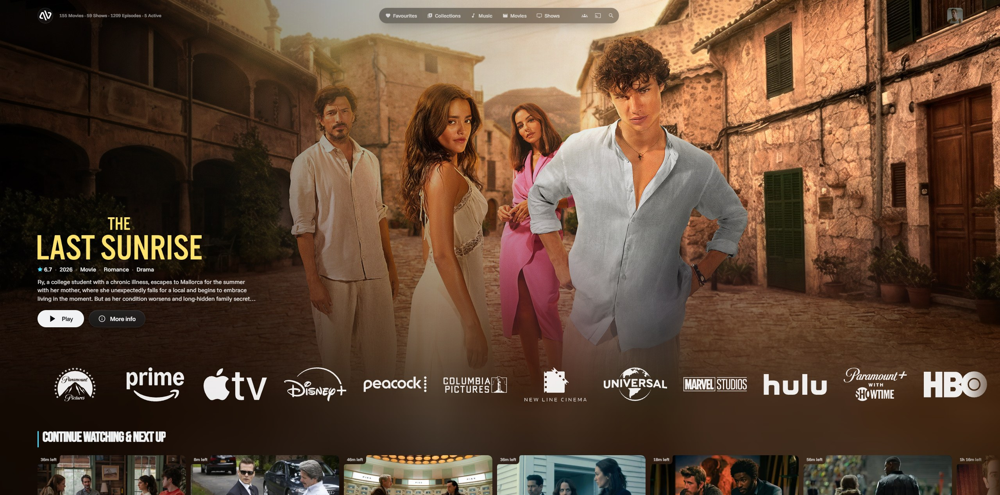
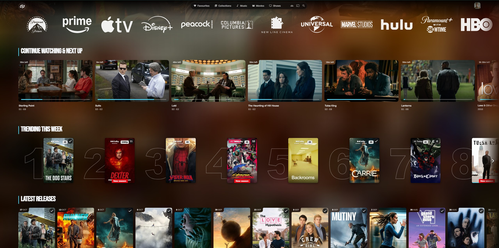
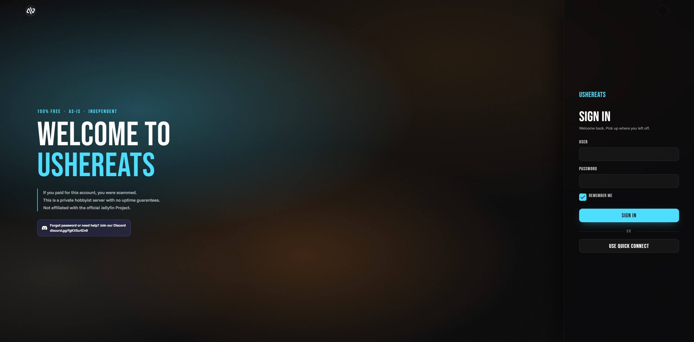

<div align="center">


# Ushereats Theme

[](https://github.com/ushereats/ushereats-modern-theme/releases/latest)
[](https://github.com/ushereats/ushereats-modern-theme/actions/workflows/build.yml)
[](https://jellyfin.org)
[](https://github.com/varunaditya-plus/SleekFin)
[](https://github.com/ushereats/ushereats-modern-theme)
[](https://github.com/ushereats/ushereats-modern-theme)

**Ushereats Theme** is an unofficial Jellyfin plugin that gives the whole web app a modern look, with SleekFin built in, and loads it from the page head so the default Jellyfin look never flashes.



</div>

**Minimum Jellyfin version:** 12.0
**Requires:** the [File Transformation](https://github.com/IAmParadox27/jellyfin-plugin-file-transformation) plugin

## Screenshots





## Features

- **Instant Loading:** The stylesheet, fonts and icon load from the page head before the first frame, so there's no flash of the default look. Scripts are bundled, minified, pre-compressed and cached for a year.
- **SleekFin Built In:** SleekFin's header, details pages and episode list are included, with the header built before the first paint. Drag your favourite items into the header bar from the settings page.
- **Hero Banner:** A full-width trending banner on the home page with logo, rating, genres, Play and More Info. Uses TMDB for trending titles.
- **Home Rows:** Continue Watching, Next Up, studios and your own rows, drawn instantly from your last visit. Only rows that changed are redrawn. One layout for everyone, edited on the plugin page.
- **Search:** A restyled search page that searches every type at once, with results cached for a minute.
- **Ambient Background:** Pages take on the colours of the title you're looking at, with an adjustable dim.
- **Poster Extras:** Quality badges (4K, HDR, Dolby), new-episode tags, release dates, watched marks and hover cards.
- **Player:** A restyled player, time remaining, and a pause screen (Netflix-style or minimal).
- **Welcome Splash:** A splash with sound on a new session, plus sign-in page extras with your Discord link.
- **Page Transitions:** Smooth page changes (Rise or Fade, adjustable length). Turned off automatically on TV, during video and with reduced motion.
- **Instant Details:** Clicking a title shows its backdrop straight away while the page loads.
- **Every Device:** Tested on desktop (landscape and portrait monitors), phones, tablets, Android TV and Xbox, with a bottom dock on phones and remote-friendly focus on TV.
- **Dashboard Skin:** A cleaner admin dashboard with server stats, recent activity and blurred IP addresses.
- **Now Playing and Library Stats:** What's playing on the server and how big your library is, at a glance.

## Installation Guide

### Option 1: Install from the Plugin Repository

1. Install the **File Transformation** plugin first and restart Jellyfin.
2. Uninstall the separate **SleekFin** plugin if you have it (it's built into this one).
3. Open **Dashboard -> Plugins -> Repositories** in Jellyfin.
4. Add this repository URL:

    ```text
    https://github.com/ushereats/ushereats-modern-theme/releases/latest/download/manifest.json
    ```

5. Open **Dashboard -> Plugins -> Catalog**.
6. Select **Ushereats Theme** and install the latest version.
7. Restart Jellyfin.
8. Confirm **Ushereats Theme** appears under **Dashboard -> Plugins -> My Plugins**.

### Option 2: Install Manually from a Release

1. Download the latest `ushereats-theme_*.zip` from the [GitHub releases page](https://github.com/ushereats/ushereats-modern-theme/releases/latest).
2. Stop Jellyfin.
3. Create a `UshereatsTheme` folder under your Jellyfin plugins directory.
4. Extract the release zip into that folder.
5. Start Jellyfin.
6. Confirm **Ushereats Theme** appears under **Dashboard -> Plugins -> My Plugins**.

### Option 3: Build from Source

1. Install Node.js 22 and the .NET 10 SDK.
2. From this repository, run:

    ```shell
    npm ci --prefix sleekfin
    npm install --no-save terser@5.31.6
    node build-assets.mjs
    dotnet publish src/Jellyfin.Plugin.UshereatsTheme/Jellyfin.Plugin.UshereatsTheme.csproj -c Release -o out
    ```

3. Stop Jellyfin.
4. Create a `UshereatsTheme` folder under your Jellyfin plugins directory.
5. Copy `Jellyfin.Plugin.UshereatsTheme.dll` from `out` into that folder.
6. Start Jellyfin.
7. Confirm **Ushereats Theme** appears under **Dashboard -> Plugins -> My Plugins**.

## Configuration & Setup

After installing, clear out anything that would load the look twice:

1. **Dashboard -> General -> Custom CSS:** delete everything (save a copy first).
2. **JS Injector** (if installed): delete old theme scripts and the KefinTweaks scripts. Home rows and search are built in.
3. **Dashboard -> Plugins -> My Plugins -> Ushereats Theme:** paste your TMDB API key, check the switches, then **Save**.
4. Hard refresh the browser (Ctrl+F5).

Every feature has its own switch on the settings page and is on by default. The settings page also has:

- **Accent colour, icon and Discord link** for the sign-in page and splash.
- **Home rows editor** for the home page layout.
- **Header bar builder** for the SleekFin header.
- **Page changes:** style (Rise or Fade) and length (200 ms by default).
- **Ambient dim, splash volume, pause screen style and delay, search colour and title.**
- **Extra CSS** for quick tweaks without rebuilding.

## Troubleshooting

- **The default Jellyfin look still shows:** Confirm **File Transformation** is installed and enabled, restart Jellyfin, then hard refresh.
- **Things load twice or look doubled:** Clear **Custom CSS** and remove old theme scripts from **JS Injector**, and uninstall the separate **SleekFin** plugin.
- **No hero banner or trending titles:** Add a TMDB API key in the plugin settings.
- **A change doesn't show up:** Hard refresh (Ctrl+F5). Each release gets a new file version, so a normal refresh is usually enough.
- **Apps other than the web app:** The theme styles the Jellyfin web app and apps that use it (Android, Android TV, Xbox, desktop). Native apps like Infuse or Swiftfin draw their own interface.

## Making Changes

- Quick tweaks: plugin settings -> **Extra CSS**.
- Bigger changes: edit `web-src/theme.css` or `web-src/js/*.js` and push to `main`. GitHub Actions builds and publishes a new release, and Jellyfin offers it as an update.
- Never edit `src/.../Assets` by hand. It's generated by `build-assets.mjs`.

## Disclaimer

This is an unofficial Jellyfin plugin. [SleekFin](https://github.com/varunaditya-plus/SleekFin) (MIT, varunaditya-plus) is included in `sleekfin/`. Studio logos are from [KefinTweaks](https://github.com/ranaldsgift/KefinTweaks) (MIT, ranaldsgift). Fonts: Funnel Sans and Bebas Neue (SIL Open Font License). Trending data from [TMDB](https://www.themoviedb.org); this product uses the TMDB API but is not endorsed or certified by TMDB.
